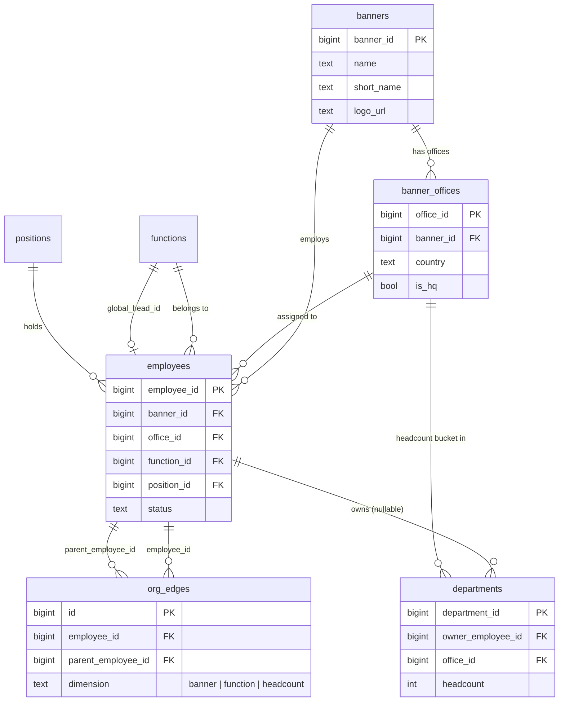
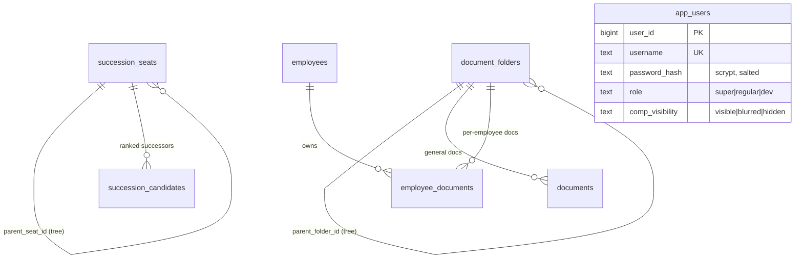

# System Audit — Royal Flush ATS

Working audit report, built section by section (see `docs/HANDOVER_PLAN.md` stage 3 — this is the prep material for that walkthrough with the client's internal team). Each section is a factual snapshot of *current* state, checked directly against the live Supabase project (`ddxuuyyienpnufltanid`) and the running code — not aspirational.

Originally completed in one pass; updated 2026-08-09 with a large follow-up batch (see §3's finding update and §5's "2026-08-09 batch") — not a full re-audit, just the delta from work done since.

Status: **6 of 6 sections done.**
1. ✅ Infrastructure & Environment
2. ✅ Data Model & Relationships
3. ✅ Security & Access Control
4. ✅ Known Issues / Tech Debt
5. ✅ Feature Completeness
6. ✅ Cost / Operating Requirements

---

## 1. Infrastructure & Environment

### Hosting & deploy target
- **Framework:** Next.js 15.5 (App Router), React 19, TypeScript. `npm run dev` for local, `npm run build && npm run start` for production. No custom server.
- **Deploy target:** Vercel (per `docs/STACK.md`) — not yet actually deployed there as of this audit; verified locally only.
- **Node requirement:** Next.js 15.5 requires **Node ≥18.18**.

### Database
- **Supabase project:** `RoyalFlush_ATS`, ref `ddxuuyyienpnufltanid`, region `ap-northeast-2`, Postgres **17.6**, status `ACTIVE_HEALTHY`.
- **Access pattern:** the app never talks to Postgres directly — all access goes through Supabase's Data API (PostgREST) via `@supabase/supabase-js`, using a **service-role** client (`src/lib/supabase/admin.ts`) that bypasses RLS. See §3 (Security) for what that means in practice.
- **Migrations:** 23 files in `docs/migrations/` (`001`–`023`), applied in order. Two (`018`/`019`) add-then-drop the same feature the same day — harmless, just history.

### Storage buckets
6 buckets, all **public-read**, write restricted to `service_role` only (confirmed: `storage.objects` has RLS enabled with **zero policies** — `anon`/`authenticated` roles can't write anything):

| Bucket | Size limit | Allowed types |
|---|---|---|
| `banner-logos` | 2 MB | png, jpeg, svg, webp |
| `documents` | 20 MB | pdf, pptx, docx, doc, ppt |
| `employee-documents` | 20 MB | pdf, pptx, docx, doc, ppt, xlsx, xls, png, jpeg |
| `employee-resumes` | 10 MB | pdf, doc, docx |
| `position-jds` | 10 MB | pdf only |
| `profile-photos` | 5 MB | png, jpeg, webp |

### Required environment variables
| Variable | Purpose | Sensitivity |
|---|---|---|
| `NEXT_PUBLIC_SUPABASE_URL` | Project API URL | public |
| `NEXT_PUBLIC_SUPABASE_ANON_KEY` | Client-side Supabase key | public (RLS-bound) |
| `SUPABASE_SERVICE_ROLE_KEY` | Server-side admin key — bypasses RLS entirely | **secret** |
| `AUTH_SECRET` | Signs session cookies (HMAC-SHA256), 32+ random chars | **secret** |
| `GEMINI_API_KEY` | Optional — falls back to a value stored in the `app_settings` table if unset | **secret** |

### AI layer
- **Provider: Google Gemini**, model `gemini-3.1-flash-lite`, via `@google/genai` (`src/lib/ai.ts`). *(`docs/STACK.md` currently says Claude/`@anthropic-ai/sdk` — that line is stale; the code is the source of truth.)*
- **Three features use it**, all fired only on explicit user click (no cron/batch/auto-generation): `generateInsights()` (Key Insights), `generateProposalAssessment()` (AI Talent Assessment on a proposal), and — added 2026-08-09 — the OrgChart OCR upload's extraction step, via a new multimodal `generateJsonFromFile()` sibling of the original text-only `generateJson()`. No rate limiting or caching around any of the calls — not needed given usage is manual-click-bounded.

---

## 2. Data Model & Relationships

Full field-by-field reference: **[`docs/SCHEMA.md`](SCHEMA.md)** — this section is the visual/relationship layer on top of it, grouped by domain so a 25-table schema is readable in one sitting. `docs/SCHEMA.md`'s own dummy-dataset section (§6) is now stale as of this audit — see the callout at the end of this section.

### 2a. Org & People (the core)



**Key relationship, easy to miss:** `org_edges` is *not* a parent column on `employees` — it's a separate edge table, and **every employee needs 3 rows in it** (one per `dimension`: `banner`, `function`, `headcount`). An employee with a missing edge row is invisible on that chart and undraggable. This is why `createEmployeeFull` / CSV import write all three at creation time.

### 2b. Compensation

```mermaid
erDiagram
    employees ||--o| employee_compensation : "1:1 current"
    employees ||--o{ compensation_history : "1 per fiscal year"

    employee_compensation {
        bigint employee_id PK_FK
        numeric base_salary
        numeric sti_target
        numeric sti_max
        numeric lti_target
        numeric lti_max
        numeric allowance_family_cover "text as of migration 023"
        numeric total_compensation "entered, not derived"
    }
    compensation_history {
        bigint id PK
        bigint employee_id FK
        int fiscal_year "unique per employee"
        numeric sti_actual_pct
        numeric lti_actual_pct
        numeric total_comp "derived: base+sti_amt+lti_amt"
    }
```

**Two different "total compensation" concepts, don't conflate them:**
- `employee_compensation.total_compensation` — a manually **entered** figure (D7), may not equal the sum of line items.
- Every "Total Compensation (calculated)" readout in the UI (Add Employee wizard, What-if scenarios, Compensation & Benefits edit) — always **derived** as `base + STI Target€ + LTI Target€ + Other Bonus`, excluding all `allowance_*`/benefit columns and both `*_max` fields.
- `compensation_history.total_comp` — a third, separate derivation: `base + sti_amount + lti_amount` (actual%-based, no other_bonus).

**Known gap (flagged, not yet fixed):** `compensation_history` has **no unique constraint** on `(employee_id, fiscal_year)` despite `SCHEMA.md` describing it as "unique on" that pair and the upsert code assuming one exists — see the background task already spawned for this (`docs/SYSTEM_AUDIT.md` §4 will cover it properly).

### 2c. Proposals (Appointment & Compensation Review)

```mermaid
erDiagram
    employees ||--o{ salary_proposals : "subject"
    salary_proposals ||--o| salary_proposal_compensation : "1:1 proposed figures"
    salary_proposals ||--o{ salary_proposal_comparisons : "pinned peers"
    salary_proposals ||--o{ salary_proposal_whatifs : "simulated scenarios"
    salary_proposals ||--o| proposal_assessments : "1:1 AI assessment"
    positions ||--o{ salary_proposals : "new_position_id (optional)"

    salary_proposals {
        bigint proposal_id PK
        bigint employee_id FK
        text status "draft|submitted|approved"
        int target_fiscal_year
    }
    proposal_assessments {
        bigint proposal_id PK_FK
        text headline
        jsonb fit_bullets
        jsonb market_bullets
        text model "which Gemini model generated it"
    }
```

A proposal's Comparison tab reuses `/comparison_v2`'s own component — `salary_proposal_comparisons` and `salary_proposal_whatifs` are just a persisted snapshot of that same board.

### 2d. Succession, Documents, Auth (lighter-weight, standalone)



`app_users` is **fully independent** of `employees` — logins are not tied to a person record. There's no FK between them at all; an HR admin logging in isn't necessarily (and usually isn't) also an `employees` row.

### Staleness callout

`docs/SCHEMA.md` §6 ("Current dummy dataset") still describes **3 mock companies** (Nexus Retail Group / Orion Financial Holdings / Vertex APAC Solutions). As of this session's work, `banners` holds the **real 8 companies** (Selfridges, De Bijenkorf, Brown Thomas Arnotts, Rinascente, Globus, Illum, KaDeWe, Europe HO) with real logos — employee records are still mock, only the company/banner layer is real now. `SCHEMA.md` §6 also doesn't yet reflect `allowance_family_cover`'s type change (numeric → text, migration 023). Both should be corrected in `SCHEMA.md` directly rather than duplicated here — noted so nobody trusts the stale version in the meantime.

---

## 3. Security & Access Control

### Authentication
- Custom username/password login (`app_users` table) — no email, no OAuth/SSO.
- Passwords hashed with Node's built-in **`scrypt`**, unique random salt per user, stored as `<saltHex>:<keyHex>`. Not reversible, not even by us.
- Login verification uses `timingSafeEqual` (constant-time comparison) — resistant to timing attacks. The "wrong username" and "wrong password" cases return an **identical** error message (`"Incorrect username or password."`), so a login attempt can't be used to enumerate valid usernames.
- **No brute-force protection** — no rate limiting, no lockout after N failed attempts, on the login action itself. Worth having before this goes in front of a real client, even a simple one (e.g. exponential backoff per username or per IP).
  - **Planned, not yet started:** migrating login to Google OAuth (with verification). Once done, this finding is largely moot — Google handles auth-attempt security itself. Until that lands, the gap above stands, so avoid spending effort on a custom rate-limiter if the OAuth migration is coming soon regardless.

### Sessions
- Stateless HMAC-SHA256 signed token (`{user_id, exp}`), signing key = `AUTH_SECRET` env var.
- Cookie `rf_session`: `httpOnly`, `secure` in production, `sameSite: "lax"`, **8-hour** expiry.
- `src/middleware.ts` verifies the signature on **every route** except `/login` and static assets (Edge-compatible check), and deletes the cookie outright if verification fails (stale or forged tokens don't linger).

### Role-based visibility (compensation & personal data)
- Three roles: `super` (sees everything) / `regular` / `dev`. `super` always sees comp + personal data regardless of the per-user override columns; everyone else defaults to **hidden** unless a `super` explicitly opts them into `visible` or `blurred` per user (`comp_visibility`, `personal_visibility` columns on `app_users`).
- **Redacted server-side**, not just hidden in the UI — `redactListItem()` / `redactDetail()` (`src/lib/permissions.ts`) NULL out compensation and retirement-age fields before the data ever leaves the server action, so a restricted user can't recover them via DevTools/network tab.
- **Write access mirrors read access** — `requireCompEditor()` / `requirePersonalEditor()` throw for anyone whose visibility is blurred/hidden, called at the top of every comp/personal mutation (`updateEmployeeCompensation`, all `compensation-history.ts` actions, `upsertPerformanceGrade`/`deletePerformanceGrade` — just added this session — etc.), so a non-privileged client can't write those fields even by invoking the server action directly, bypassing the UI entirely.

### ✅ Fixed (2026-08-09): two admin surfaces had no server-side gate
`src/app/actions/app-users.ts` (real user management — create/delete users, change roles, reset anyone's password) was already correctly gated with `requireSuper()` on every exported function. Two adjacent actions on the **same `/settings` page** were not:

- **`src/app/actions/settings.ts`** (`saveSetting`) — no permission check at all. Any logged-in user, regardless of role, could overwrite the shared Gemini API key.
- **`src/app/actions/banners.ts`** (`createBanner`, `updateBanner`, `uploadBannerLogo`, `removeBannerLogo`) — same gap, plus the same gap on the new office-management actions added the same session (`src/app/actions/org.ts`: `createBannerOffice`, `updateBannerOffice`, `deleteBannerOffice`).

`await requireSuper()` added to every mutation above (read-only listers left open). The `/settings` **page itself** also now conditionally renders the whole API-key/banner-admin section behind `isSuper` (`src/app/settings/page.tsx`) instead of rendering it unconditionally and letting the action-level gate be the only thing stopping a non-super click — a non-super visitor now sees "These settings are super-user only." Verified against real logins (temp `regular` and temp `super` test accounts, both deleted after).

### Secrets storage
- `SUPABASE_SERVICE_ROLE_KEY` / `AUTH_SECRET` — env vars only, never touch the database.
- **Gemini API key, if set via the Settings UI, is stored in plaintext** in `app_settings.value` (a plain `text` column) — not encrypted at rest beyond whatever Postgres/Supabase provides by default. Combined with the gap above, this key is currently writable (and its masked state readable) by any logged-in user, not just admins.

### Database-level access (RLS)
- Confirmed directly against the live project: RLS is **enabled** on every table, but the policy is uniformly `FOR ALL TO authenticated USING (true)` (e.g. `employees`, `employee_compensation`) — i.e. RLS grants nothing beyond "any authenticated Supabase user can do anything." In practice this is moot either way, because **the app never uses the `authenticated` role** — every server action goes through `src/lib/supabase/admin.ts`'s `service_role` client, which bypasses RLS entirely. All real access control lives in the app layer (`permissions.ts`, `requireSuper()`, middleware), not the database.
- `app_users` has **no RLS policy at all** (enabled, zero policies = deny-all for `anon`/`authenticated`) — correct, since it's only ever touched via the service-role client during login.
- `storage.objects` similarly has RLS enabled with **zero policies**, so only `service_role` can write to any bucket — confirmed in §1.

### Infrastructure access (the three pieces from the handover deck)
Database, Domain/Hosting, and Source Code each sit behind their own vendor account login (Supabase, Vercel, Git host) — an outsider needs credentials to all three separately, not just one. Covered in full in the client-facing deck (`system-handoff-*.pptx`, root of repo) and `docs/HANDOVER_PLAN.md`.

## 4. Known Issues / Tech Debt

### Pre-existing TypeScript errors
Confirmed via `npx tsc --noEmit` — present before this session's changes, not introduced by them (none touch the files below). 7 errors across 5 files:

| File | Issue |
|---|---|
| `src/components/org-chart-d3.tsx`, `src/components/succession-chart-d3.tsx` | `d3-org-chart` has no bundled types and no `@types/d3-org-chart` package exists — every import resolves to `any`. Cosmetic (doesn't break the build, Next transpiles JS regardless), but no type safety on the whole org-chart layer. Fix: a local `declare module 'd3-org-chart'` ambient type file. |
| `src/components/scores-card.tsx:32-33` | `saveEmployeeScores()` requires `{ leadership: number; ... }` (non-null), but `clamp()` returns `number \| null` and its output is passed straight in. Almost certainly harmless in practice (`draft` always starts from real defaults), but not proven to the type checker. |
| `src/app/employees/[id]/page.tsx:214` | `ScoresCard`'s `req` prop expects `{ leadership, experiences, skill, market }`; what's passed is shaped `{ req_leadership, req_experiences, req_skill, req_market }` (the raw DB column names from `positions`) — a field-naming mismatch, not remapped before the prop boundary. |
| `src/components/ui/async-filter-multi-select.tsx:5` | Imports `@/hooks/use-debounce`, which doesn't exist — the file even has its own comment: *"We might need to create this if it doesn't exist."* Confirmed **not imported anywhere else in the app** (`grep` finds only its own file) — this looks like scaffolded-but-never-finished code, not a live bug. Candidate for either finishing or deleting. |

### Database
- **`compensation_history` has no unique constraint** on `(employee_id, fiscal_year)`, despite `docs/SCHEMA.md` documenting one and `upsertCompensationHistory()`'s code assuming one via `onConflict: "employee_id,fiscal_year"`. Backfilling an existing fiscal year for an employee will error instead of updating the row. Flagged as a separate background task already (not fixed as part of this session's work, out of scope for the comp-field feedback batch).

### Authorization
- ~~`/settings`'s API-key and banner-admin actions have no server-side role gate~~ — **fixed 2026-08-09**, see §3.
- No brute-force protection on login — see §3. Superseded by the planned Google OAuth migration (not yet started) once that lands.

### Documentation drift (now fixed where found this session)
- `docs/STACK.md` says the AI layer is Claude/`@anthropic-ai/sdk` — actually Gemini (`@google/genai`, `gemini-3.1-flash-lite`). **Not yet corrected** (only flagged, in §1 above and `docs/HANDOVER_PLAN.md`).
- `docs/SCHEMA.md` §6 described the 3 mock banners as current, and `allowance_family_cover` as numeric — **corrected this session** after the real-banner-data work and the Family Cover → text change.

### Already-known, deferred (carried over from `docs/SCHEMA.md` §9, still true)
- Role-based access is coarse (`super`/`regular`/`dev` + per-user comp/personal visibility overrides) — no "manager sees only their own team" scoping.
- PDF export is browser-print-based, no server-side PDF library.
- Bulk Excel (multi-sheet) import — planned, not built (CSV import exists).
- Dummy employee data still points at external `pravatar.cc` placeholder photos, not real files in the `profile-photos` bucket (real uploads do land there correctly).

## 5. Feature Completeness

Full history: `docs/FEEDBACK_TRACKER.md`. This is the current-state summary, cross-checked against the live database rather than taken at face value from the tracker (one entry there — banner logos — was stale and has been corrected as part of this audit).

### Done
- **Original 17-item discussion round:** 16 of 17 shipped, 1 declined (LinkedIn profile import).
- **Access control** (4 phases): username/password login, role + per-user comp/personal visibility, server-side redaction, write-protection mirroring read rights, admin panel for user management.
- **Org chart rebuild** (`d3-org-chart`): expand/collapse, zoom, drag-and-drop reassignment with a fit-check scorecard, Compact/Stack V1/Stack V2 layout modes, PPTX + PNG export, cross-company dashed connectors, real "Head of Function" cross-company reporting.
- **Positions & competency scoring**, Comparison what-if scenarios, CSV employee import/export, Document Center (folders + inline preview, Google-Drive-style), per-employee documents, JD storage by position.
- **Company (banner) master data**: real 8 banners with real logos — done this session (§2).
- **This session's comp/performance feedback batch** (7 items): What-if panel STI/LTI as %, field reordering, Allowance/Benefit relabeling + Family Cover → free text, Performance grade edit path (built from nothing), month/day-only Effective Date, € hints on Eligible/Actual %, Total Compensation formula caption.
- **Org chart node polish**: larger banner logo, higher-contrast subordinate-count badge; later in the same work stream, the node was simplified further to **logo-only** (dropped the color-coded short-name fallback — `banner_short_name` still drives exports/legends, just not the node card).
- **2026-08-05/09 batch** (one continuous session):
  - Fixed a real data-corruption bug in the Compensation & Benefits edit dialog: it rounded stored € bonus amounts to a whole-number % on open, then recomputed € from that rounded % on save — silently drifting STI/LTI values on every save, even with no fields touched. Fixed with 2dp rounding + dirty-field tracking so an untouched field can never drift.
  - Employee profile: Estimated Retirement now shows years-from-now; Compensation & Benefits card shows precise % alongside € for STI/LTI Target/Max.
  - Print/PDF export (`export-profile-html.ts`) brought back in sync with the on-screen profile (was missing Nationality, Gender, Age, Estimated Retirement, STI Max, LTI Max, two allowance rows, and the STI/LTI % display).
  - Comparison tab removed from nav (Proposals already embeds the same comparison UI) — routes left in place, not deleted.
  - Add Employee wizard friction pass: optional "Reports to" field at creation (a new hire no longer lands as an unplaced org-chart root by default), Review step now itemizes every compensation field and lists actual Career/Background entries instead of just counts, quick-add panels clear on close, Cancel uses a styled confirm dialog instead of a native `confirm()`.
  - Nationality editing uses the same searchable country dropdown on both create (wizard) and edit (profile) — was a bare text input on the edit path.
  - **Full Banner management** in Settings: create a company from scratch, per-company country-office CRUD (previously only reachable as a side effect of the wizard's quick-add), and an in-app logo crop tool (`react-easy-crop`) framed at the actual node aspect ratio — logo uploads previously had no crop step at all.
  - **Free-form planning tag**: one preset color per employee (`employees.tag_color`, migration 024), no HR meaning, set from a popover on the profile header, rendered as a 4px stripe on every org-chart node.
  - **CSV import dedup + review**: previously every row was inserted blindly with no duplicate check, and any row with an unresolvable Company/Country/Position was silently dropped. Now a dry-run analysis (fuzzy name-match via a small in-house Levenshtein utility, `src/lib/fuzzy.ts`) buckets each row before anything is written, with a review screen to skip/confirm duplicates and inline "+ New" office/position resolution.
  - **OrgChart OCR upload** (`docs/ORGCHART_OCR_PLAN.md`, now built): upload a PDF/image chart, Gemini vision (`generateJsonFromFile`, new multimodal sibling of the existing `generateJson`) extracts people + reporting lines, matched deterministically against existing employees, reviewed before commit. Verified against a real 10-page sample chart. Known v1 gaps: extraction completeness on very large multi-page charts still needs prompt/token tuning (a first pass silently stopped after page 1 until the prompt was made explicit about multi-page files); "needs review" conflicts (chart disagrees with an existing employee's company/title) are surfaced with a profile link rather than resolved inline, by design — reassigning an existing person's org placement goes through the same editor every other move does, not a bulk-import screen.
  - Fixed a hydration mismatch on Settings → Users & access (`new Date().toLocaleDateString()` with no explicit locale disagreed between server and client — server resolved to `th-TH`/Buddhist calendar, client to `en-US`).
  - Fixed the two-admin-surfaces-with-no-gate finding from §3 (see above).
  - **Positions scoped per company** (mig 025): `positions` was a fully global/shared table — one "CEO" row used identically by every company, so its competency requirement scores couldn't actually differ by company even though the fit-check scorecard treats them as if they should. Added `positions.banner_id`, replaced the old globally-unique `title` constraint with `UNIQUE(banner_id, title, function_id)`, and cloned every existing shared position once per company that had employees on it (existing req scores carried over as the starting point, repointing `employees`/`succession_seats`/`salary_proposals` to the correct clone). Every position picker/quick-add in the app (Positions admin, Add Employee wizard, CSV import, OrgChart OCR, Proposals "New Position") now scopes to the relevant company.
  - **OrgChart OCR: pre-select company before upload.** Previously each "new" person's company was guessed from Gemini's OCR'd `banner_text` label per node — unreliable, and now also insufficient since position matching needs a `banner_id` up front. The upload dialog now opens on a "pick Company (required) + Function (optional)" step first; every "new" node's office/position pickers are scoped to that one company, and a mismatch between the chart's own `banner_text` and the picked company is shown as a soft cross-check warning instead of driving resolution.
  - **Fixed org chart top-level roots packing into a 2×2 grid in Compact mode.** d3-org-chart's compact layout pairs collapsed siblings 2-per-row purely by "does this node currently lack visible children" — the synthetic multi-company anchor's own children (unrelated top-level people, always collapsed by default) always looked like a pairable set to it. Patched to exempt just those nodes from pairing; every other level still packs 2-per-row exactly as before.
  - **2026-08-10 — Concurrent positions, the "seat model" (mig 026), previously tracked as "Blocked on a client decision."** The org chart's node identity moves from `employee_id` to a new `employee_positions` row (`employee_position_id, employee_id, position_title, function_id, banner_id, office_id, is_primary`) — a person holding two positions at once (own title, own company/office, own manager) now shows as two separate, independently-placed nodes in every dimension, each with its own reporting line. `org_edges` is re-keyed onto `employee_position_id`; `employees.position_id/position_title/function_id/banner_id/office_id` are kept as a synced "primary position cache" so every display-only reader elsewhere in the app (CSV import, AI Assessment, PDF export, etc.) needed zero changes — only the org-tree builders, FTE/headcount counting (now counts seats, not people, matching the "FTE counts each seat separately" requirement), and the org-edge mutators became position-aware. New Positions card on the employee profile (`src/components/positions-card.tsx`, `src/app/actions/employee-positions.ts`) lists every position a person holds and lets HR add a concurrent one — its own title, function, company/office, and manager, all set at creation time. Deliberately out of scope for v1: `succession_seats`, `functions.global_head_id`, `banner_offices.country_head_id`, and `departments.owner_employee_id` all stay employee-id-keyed (resolved via primary position where relevant); the Add Employee wizard and CSV/OCR import still only ever create one (primary) position at intake.
  - **2026-08-13 — Performance Management, phase 1 (mig 027).** `performance_grades` had recorded an A/A-/B+ outcome per year since day one with **no record of the work behind it** — no goals, no achievement, nothing tying a grade to anything. Three new tables fill that in: `performance_cycles` (the review year) → `banner_goals` (what a company is aiming for) → `employee_targets` (what a seat is doing about it, optionally aligned to a company goal). Targets key on **`employee_position_id`, not `employee_id`** — a concurrent position at another company therefore carries a genuinely separate set, keeping the per-company view clean and matching the org chart, whose nodes are already positions. That last point is what lets the new page reuse `OrgChartD3` wholesale rather than growing a second chart: two optional props (`perf`, `readOnly` + an `onNodeClick` override) light up a bullet bar on each card and disable drag-to-reassign, with every existing org page byte-identical when they're absent. New top-level **Performance** nav tab (after Employees) holding two in-page tabs — Overview (chart + "N/M seats have targets" KPI + goal summary + a slide-up per-seat target drawer) and Company Goals (full-width goal CRUD showing how many individual targets align to each, so a goal nobody picked up is visible). Also a read-only targets card on the employee profile beneath the existing grades card. All progress maths lives in one shared `src/lib/performance.ts` so server and client can't drift: progress is `actual/target` unless a manual `progress_pct` overrides it (the escape hatch for non-numeric goals *and* for "lower is better" metrics, which phase 1 has no direction flag for), rollup is weighted (`Σ(pct×weight)/Σ(weight)`) and skips unreported targets rather than scoring them as failures, and the bar is a **bullet chart, not a progress bar** — a plain bar clips at 100% and so can't show over-achievement, which is the one thing a target view must show. Status colour never carries meaning alone (a figure or label always sits beside it), which is both the accessibility rule and what keeps it readable next to the per-employee planning tag that already owns the card's tint. Deliberately out of scope for phase 1: check-in history, approval/self-assessment workflow, deriving the grade from rollup, PPTX export, and nudges for people who haven't set targets — the `status` columns and the target→goal link leave room for all of them without another migration. Target writes are **not** behind `requireCompEditor` the way grade writes are: a grade feeds pay, a target is the operational record HR broadly needs to maintain. **Layout reworked the same day against the client's own sketch:** the per-seat editor moved from a modal bottom drawer to an **inline panel beneath the chart** (so the chart and the row being edited stay on screen together, and the panel is visible as an empty state before anything is picked), the chart gained a banner logo/name header strip, a placeholder card for the not-yet-designed scoring matrix sits beside the editor, and the editor itself became a plain **table** — goal / weight / target / actual / achieved, with an "Overall" footer row — rather than stacked cards. Company-goal achievement also stopped being purely manual: with no figure entered it now **rolls up from the individual targets aligned to it**, labelled as derived so it's never confused with an entry. Finally, **the company itself became a node on the chart** — injected above each company's root person by the page (not by `getOrgFlat`, which the other three org pages share and have no use for it). Clicking it opens the same panel and the same table, just filled with that company's objectives instead of a person's targets, which is what makes the cascade legible in one place: the company sets "revenue 300M", someone under it adds "aftersale 150M" and picks that objective from a dropdown, and each objective row then shows how many targets picked it up. Choosing no objective stays valid throughout — not every function moves a company number directly. **Cycles and export closed the two gaps left after that:** `createCycle`/`setCycleStatus` existed as actions but were wired to nothing, so only the seeded FY2026 was ever reachable — there's now a New cycle dialog that creates the next year and, by default, **copies the previous year forward** (every objective and target, with who they belong to and which objective each serves, but achievement cleared — the plan is what's reused, not the result; targets whose seat no longer exists are dropped rather than failing the copy). Viewing any past year is just the existing dropdown; a side-by-side year comparison was explicitly declined as more work than it's worth for now. On export, the page had been showing the org chart's own PPTX button, which exports a plain reporting tree carrying **none** of the objectives, achievement or weights the page exists for — and which had started mis-rendering the new company nodes as nameless person boxes. That button is hidden under the performance overlay and replaced by two purpose-built exports: a company deck (objectives table, the "N/M seats have targets" KPI, and a paged per-person standings table) and a one-person sheet whose targets stay grouped under their objective exactly as on screen. Both colour the achievement figure on the same below/near/met bands, always beside the number rather than instead of it. **Mig 028 then closed a data-integrity hole found by asking what happens when people leave:** a target's company was being read live off its seat, so transferring someone rewrote history — a closed year's figures for their old company would quietly stop including work genuinely done there, and the app couldn't even tell they'd been there. `employee_targets.banner_id` is now snapshotted at creation (the target still *belongs* to the person and follows them; this is the separate question of whose books it was recorded against). On top of that: people who transferred out now appear in a "No longer in this company" card in the right panel, since they have no node left in that chart and would otherwise vanish from the cycle entirely, and resigned people — who do keep their seat — get an explicit red Resigned chip on their node instead of only the easily-missed dimming. Verified end to end by moving a seat between companies and marking another resigned: the old company's objective still read 87% off the same three aligned targets, the mover surfaced as "Moved to De Bijenkorf · 3 targets recorded here", and the resignee stayed on the chart flagged.
  - **2026-08-12 — Org chart node color/chevron polish, Company Summary panel link fix, and compact-mode grid rewrite.** Node tag-color rendering changed from a 4px left-edge stripe to a full-card tint (translucent background + matching border), and the expand/collapse chevron dropped its filled gray pill background (was `background:#eef2f7` + a redundant child count) down to a bare arrow glyph — both driven directly from live-screenshot feedback. The org chart's node-click info dialog also gained a working `TagColorPicker` — it previously only rendered an already-set tag color with no way to actually set one. Separately, `/org/banner`'s Company Summary panel (company/country row links) now filters the org chart on the same page (`/org/banner?company=X`) instead of navigating away to the Employees list. Largest change: **d3-org-chart's Compact-mode sibling layout was replaced with a custom adaptive grid** (monkeypatching `calculateCompactFlexDimensions`/`calculateCompactFlexPositions` and the `layout.top` link-routing bindings, since the library exposes no public per-level column config). The stock algorithm only ever paired 2 collapsed siblings per row, and — because its "which siblings are pairable" filter re-evaluates on every render — expanding just one sibling in a group reshuffled every other sibling's visible order and knocked the parent's connecting line off-center. The rewrite (a) bails out to the library's own standard (non-compact) tree layout whenever a sibling group is a mix of collapsed/expanded nodes, keeping order stable regardless of what's expanded, and (b) for fully-collapsed groups, lays out up to 4 columns with evenly-sized gaps and a correctly-centered trunk line. Verified live against both the reported bug case (a 3-sibling group whose order/centering broke on partial expand) and a 6-direct-report case (confirms the 4-column wrap and tightened gap).

### Blocked on a client decision or client data (not started)
1. **Importing the real 35-employee dataset.** Two open questions: replace vs. add to the current dummy data, and where reporting lines come from (the source CSV has no manager column).
2. **Business Entity tab** (legal ownership structure). Waiting on real data; also an open design question since ownership is a DAG (multiple shareholders possible), not a tree, and the charting library requires a tree.

### Planned, decided, not yet started
- **Google OAuth login.** Replaces the current username/password + scrypt flow (§3) with Google sign-in and verification. Not scoped/built yet — noted here so it isn't duplicated or contradicted by unrelated auth-hardening work in the meantime (see §3's brute-force finding).

### Partially shipped
- **Item 14 (deep org-chart layout):** Stack V1/V2 + "Full Org" button done on-screen; **not** ported to PPTX exports (see `docs/PPTX_HANDOFF.md`).
- **Access control Phase 4** (optional): masked compensation doesn't extend to PPTX/HTML exports yet — shows a plain "—" instead of the on-screen blurred treatment.

### Verification gap worth knowing about
Per the tracker: **no PPTX export has ever actually been opened in real PowerPoint.** Every PPTX change has been verified by typecheck + a standalone Node script exercising `pptxgenjs` directly, never the real in-app export button, never a rendered deck. Structurally sound, visually unconfirmed.

## 6. Cost / Operating Requirements

Full client-facing version: **`system-handoff-*.pptx`** (repo root) — 5-slide deck covering ownership transfer, infra specs, data security, and pricing, built for a client presentation. This section is the numbers-only summary for internal reference; regenerate the deck via `node scripts/generate_ops_handoff_pptx.mjs` if these change.

### What's required to run this system
| Component | Vendor | Notes |
|---|---|---|
| Database | Supabase Pro | 8 GB DB, 100 GB file storage, Micro compute, 100K MAU auth, daily backups |
| Domain & Hosting | Vercel Pro | 1 TB bandwidth/mo, 1,000 GB-hours functions, custom domain + SSL |
| Source Code | Git host (GitHub or — per discussion — likely Azure DevOps) | Full commit history transferable via `git push --mirror`, not vendor-specific |
| AI (Key Insights, AI Assessment) | Google Gemini API | Usage-based, user-click-triggered only (no batch/cron) |

All three infrastructure pieces (Database/Domain/Source Code) are **fully transferable** to client-owned accounts — no vendor lock-in by design. Detail in `docs/HANDOVER_PLAN.md` §2–3.

### Monthly running cost (as quoted, USD, 15% service margin included in each line)
| Item | Cost |
|---|---|
| Database — Supabase Pro | $28.75 |
| Domain & Hosting — Vercel Pro (1 seat) | $27.60 |
| Domain registration (amortized) | $1.73 |
| **Fixed subtotal** | **$58.08/mo** |
| Gemini API (variable, usage-based) | $5.75–$11.50/mo |

Note: Supabase usage-based overages beyond plan limits (storage/bandwidth) bill separately at cost — typical small production apps add another $10–50/month once real usage kicks in. Not included in the fixed figure above.

---

*Audit complete — all 6 sections, updated 2026-08-09 with the delta above. Next: export to Google Docs for the client walkthrough (per discussion, once this markdown version is signed off).*
